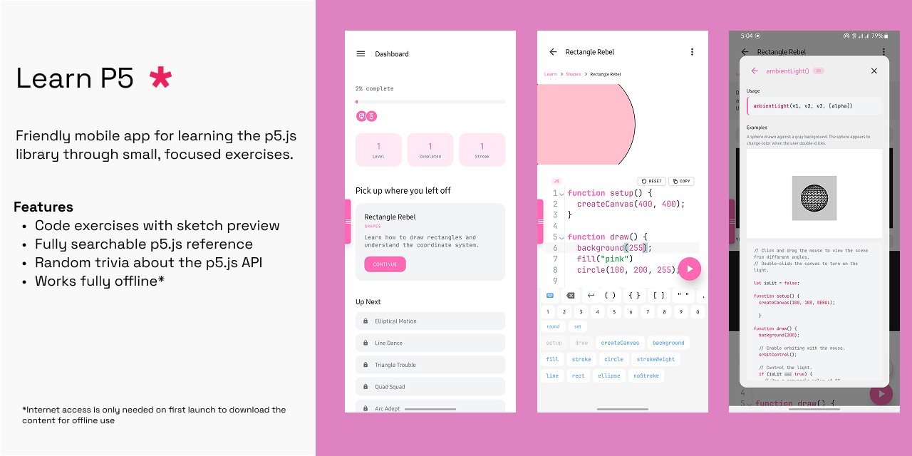

# Learn P5

> [!warning]
>
> This app is still in development (no stable v1 release yet), behaviour and the
> UI presentation may change and/or break.

## Friendly mobile app for learning p5.js

**Learn P5** aims to make learning (creative) coding with p5.js a casual and
paced experience. The app provides exercises for exploring each documented
symbol in the p5.js public API including solution preview and a code block for
editing your solution. It builds around the p5.js library and **it is not meant
to be a replacement for the [web editor](https://editor.p5js.org)**.

The exercises are based on the examples and official documentation from the
p5.js source itself and can be found
[in this repository](https://github.com/prjctimg/learn-p5-content) and they
cover every public exported module.

Learn P5 is inspired by the (now deprecated) Grasshopper app by Google's Area120
lab.

[This is a Google Summer of Code (2026) project](https://summerofcode.withgoogle.com/programs/2026/projects/wmrV9qBT)
for the [Processing Foundation](https://processingfoundation.org).

## Installing

> [!note]
>
> Only Android builds are available at the moment, iOS 🍎 support is planned and
> coming soon.

Grab a release build from the
[GitHub releases page](https://github.com/prjctimg/learn-p5/releases/latest).

Google Playstore and F-Droid releases are under review and coming soon.

> [!warning]
>
> These are beta testing releases and are currently not signed by Google Play
> Store.
>
> To minimize risks, be sure to get the release APK from this repository's
> releases page and scan the app using Google Play Protect.

## Code of Conduct

Open source works because people from all walks of life contribute their
perspectives to it, this project believes that we can build around this empathy
and mutual respect.

This project uses the
[same Code of Conduct as p5.js](https://p5js.org/code-of-conduct/).

## Contributing

All contributions are welcome to the project, whether it's improvements to the
app code or the exercise content.

See the [contributing guidelines](./CONTRIBUTING.md) for more information on how
to contribute to the project.

## Acknowledgements

This project would not be possible without the feedback, prior work and guidance
from the [Processing](https://processingfoundation.org) and
[p5.js](https://p5js.org) communities at large.

## Contributors

<!-- CONTRIBUTORS -->

  

<!-- /CONTRIBUTORS -->

## License

Free software released under the [GPL-3.0-or-later](./LICENSE).
